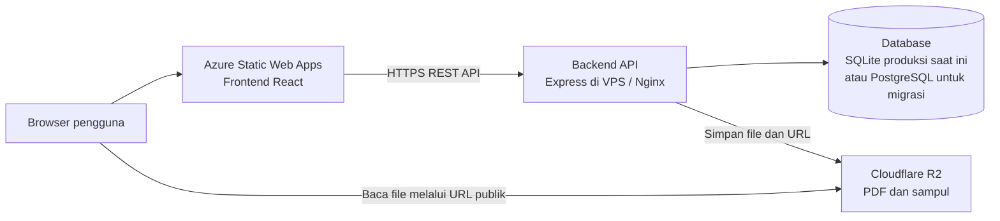

# Edulib

### Modern Digital Library

> **Temukan bacaan, perluas wawasan, dan lanjutkan belajar.**

Edulib adalah perpustakaan digital untuk membantu pelajar dan pembaca menemukan koleksi buku pendidikan serta literatur akademis, lalu membacanya langsung melalui browser.

**[Kunjungi Edulib](https://edulib.id/)**

[](https://react.dev/)
[](https://nodejs.org/)

## Daftar Isi

- [Tentang Edulib](#tentang-edulib)
- [Fitur](#fitur)
- [Teknologi](#teknologi)
- [Arsitektur](#arsitektur)
- [Struktur Repository](#struktur-repository)
- [Menjalankan Secara Lokal](#menjalankan-secara-lokal)
- [Konfigurasi](#konfigurasi)
- [Pengujian dan Kualitas](#pengujian-dan-kualitas)
- [Deployment](#deployment)
- [Roadmap: Edulib Patch 2.0](#roadmap-edulib-patch-20)
- [Status dan Kontribusi](#status-dan-kontribusi)
- [Dokumentasi](#dokumentasi)

## Tentang Edulib

Akses terhadap bacaan pendidikan dan literatur akademis sebaiknya mudah ditemukan dan nyaman dibaca. Edulib mengembangkan koleksi digital yang terorganisasi, pencarian buku, dan reader PDF dalam satu pengalaman berbasis web.

Sasaran Edulib adalah pelajar, mahasiswa, dan pembaca yang ingin menjelajahi sumber bacaan pendidikan. Visi jangka panjangnya adalah pengalaman membaca yang mudah diakses dan dipersonalisasi, ditopang fondasi teknis yang aman, andal, dan mudah dipelihara.

> **Arah produk:** Edulib sedang beralih menuju platform yang berfokus pada perpustakaan digital. Career Exploration masih tampak pada sebagian antarmuka saat ini; penghapusannya direncanakan untuk Patch 2.0 dan belum dirilis.

## Fitur

Fitur berikut tersedia pada implementasi saat ini:

- **Katalog dan kategori buku** berdasarkan bidang dan sub-bidang.
- **Penemuan dan pencarian** koleksi melalui halaman pustaka, kategori, dan hasil pencarian.
- **Reader PDF terintegrasi** untuk membaca dokumen dari browser.
- **Progres membaca** yang disimpan per pengguna dan buku.
- **Catatan pribadi** yang terkait dengan halaman bacaan.
- **Registrasi dan login** pengguna menggunakan autentikasi JWT.
- **Dashboard pengguna** untuk melihat bacaan terakhir dan catatan.
- **Backoffice admin** untuk mengelola koleksi dan mengunggah PDF serta sampul.
- **Penyimpanan media Cloudflare R2**; database menyimpan referensi URL file.

Google Sign-In dan Community Upload belum tersedia. Keduanya tercantum sebagai rencana Patch 2.0.

## Teknologi

| Lapisan | Teknologi | Peran |
|---|---|---|
| Frontend | React 19, Vite 8 | Antarmuka single-page application |
| Styling | Tailwind CSS 4 | Sistem styling antarmuka |
| Navigasi | React Router 7 | Routing halaman |
| Pembaca dokumen | `react-pdf` | Render PDF di browser |
| Backend | Node.js 22, Express 4 | REST API |
| Autentikasi | JWT, bcrypt | Token sesi dan hash password |
| Akses data | Knex.js | Query dan migrasi database |
| Database | SQLite; konfigurasi Knex untuk PostgreSQL | Metadata, akun, progres, dan catatan |
| File | Cloudflare R2 | Penyimpanan PDF dan sampul melalui API kompatibel S3 |
| Hosting frontend | Azure Static Web Apps | Build dan hosting frontend |
| Hosting backend | VPS, Nginx | API di belakang reverse proxy |

Database lokal secara default menggunakan SQLite. Knex dikonfigurasi untuk PostgreSQL melalui `DB_CLIENT=pg`; konfigurasi tersebut menyediakan jalur migrasi, bukan bukti bahwa PostgreSQL sudah digunakan di produksi. Driver PostgreSQL tidak tercantum sebagai dependensi langsung di `package.json`, sehingga penggunaan PostgreSQL memerlukan driver yang sesuai. Docker Compose tidak ditemukan pada checkout ini dan bukan prasyarat quickstart lokal.

## Arsitektur



Frontend diterbitkan terpisah dari API. Dokumentasi teknis mencatat SQLite untuk produksi; konfigurasi proyek menyediakan opsi PostgreSQL, tetapi aktivasi produksi dan driver PostgreSQL tidak terverifikasi pada checkout ini. Berkas PDF dan sampul disimpan di R2, bukan sebagai koleksi media di database.

## Struktur Repository

```text
.
├── frontend/             # Aplikasi React dan konfigurasi Vite
├── backend/              # Express API, routes, middleware, dan model DB
├── database/migrations/  # Migrasi skema Knex
├── scripts/              # Seed, administrasi, backup, dan deployment backend
├── test/                 # Pengujian Node.js
├── docs/                 # Konteks proyek dan dokumentasi teknis
├── nginx/                # Konfigurasi reverse proxy
├── .github/workflows/    # Workflow deployment frontend dan backend
├── knexfile.js           # Konfigurasi Knex CLI
└── package.json          # Skrip dan dependensi backend
```

## Menjalankan Secara Lokal

### Prasyarat

- Node.js 22
- npm
- Kredensial Cloudflare R2 hanya jika menguji upload media
- Resend API key hanya jika menguji pengiriman email reset password

### Instalasi

1. Clone repository dan masuk ke direktori proyek:

   ```sh
   git clone https://github.com/Ucup-Pristel/Perpustakaan.git
   cd Perpustakaan
   ```

2. Instal dependensi backend:

   ```sh
   npm ci
   ```

3. Instal dependensi frontend:

   ```sh
   cd frontend
   npm ci
   cd ..
   ```

4. Buat konfigurasi backend lokal:

   ```sh
   cp .env.example .env
   ```

   Isi `JWT_SECRET` dengan nilai acak lokal. Nilai dapat dibuat tanpa menyimpan rahasia ke repository:

   ```sh
   node -e "console.log(require('crypto').randomBytes(48).toString('hex'))"
   ```

   Untuk penggunaan lokal, biarkan `DB_CLIENT=sqlite3` dan gunakan `DB_FILENAME=./database/ucup-edu-lib.db`. Migrasi membuat skema database. `npm run seed` tersedia untuk mengisi data contoh; periksa `scripts/seed-db.js` sebelum menjalankannya pada database berisi data.

   ```sh
   npm run migrate
   npm run seed
   ```

5. Jalankan backend dan frontend di dua terminal dari root proyek:

   Terminal backend:

   ```sh
   npm run dev
   ```

   Terminal frontend:

   ```sh
   cd frontend
   npm run dev
   ```

6. Buka alamat lokal Vite yang ditampilkan di terminal (umumnya `http://localhost:5173`). Vite meneruskan request `/api` ke backend pada `http://127.0.0.1:3000`.

Login dan registrasi lokal dapat memakai SQLite dan `JWT_SECRET`. Pengiriman email reset password memerlukan konfigurasi Resend. Upload PDF dan sampul memerlukan konfigurasi bucket Cloudflare R2 yang dapat diakses backend.

## Konfigurasi

Salin `.env.example` ke `.env` untuk backend. `frontend/.env.example` memuat variabel build frontend. Jangan commit nilai rahasia.

| Variabel | Sisi | Kebutuhan | Keterangan |
|---|---|---|---|
| `PORT` | Backend | Opsional | Port server; default aplikasi 3000 |
| `HOST` | Backend | Opsional | Alamat bind; default `127.0.0.1` |
| `JWT_SECRET` | Backend | Wajib untuk autentikasi | Secret penandatangan JWT; isi dengan nilai kuat |
| `FRONTEND_URL` | Backend | Opsional | Origin frontend untuk CORS; contoh di template mengarah ke domain Edulib |
| `DB_CLIENT` | Backend | Opsional | `sqlite3` (default) atau `pg` |
| `DB_FILENAME` | Backend | Opsional | Path database SQLite; default `./database/ucup-edu-lib.db` |
| `DB_HOST`, `DB_PORT`, `DB_DATABASE`, `DB_USER`, `DB_PASSWORD` | Backend | PostgreSQL saja | Parameter koneksi saat `DB_CLIENT=pg`; driver PostgreSQL perlu tersedia |
| `R2_ACCOUNT_ID`, `R2_ACCESS_KEY_ID`, `R2_SECRET_ACCESS_KEY`, `R2_BUCKET_NAME`, `R2_PUBLIC_URL` | Backend | Upload/media | Kredensial dan URL publik bucket Cloudflare R2 |
| `RESEND_API_KEY` | Backend | Reset email saja | API key Resend untuk email reset password |
| `MAIL_FROM` | Backend | Opsional | Nama/alamat pengirim email sesuai konfigurasi mailer |
| `PASSWORD_RESET_BASE_URL` | Backend | Opsional | Base URL halaman reset password |
| `VITE_API_URL` | Frontend | Opsional | Base URL API saat build; kosongkan untuk pengembangan dengan proxy Vite |
| `VITE_APPLICATIONINSIGHTS_CONNECTION_STRING` | Frontend | Opsional | Mengaktifkan Application Insights bila diisi |

Variabel berawalan `VITE_` menjadi bagian dari bundle browser. Jangan menaruh secret di dalamnya.

## Pengujian dan Kualitas

Jalankan pengujian backend dari root:

```sh
npm test
```

Skrip backend juga menyediakan pemeriksaan status migrasi:

```sh
npm run migrate:status
```


```sh
cd frontend
npm run lint
npm run build
```

Workflow backend menjalankan pemeriksaan syntax, `npm test`, dan audit dependensi produksi sebelum deployment. Workflow Azure Static Web Apps membangun dan menerbitkan frontend secara terpisah. Periksa [workflow GitHub Actions](.github/workflows/) untuk rincian job.

## Deployment

- **Frontend:** Azure Static Web Apps melalui [workflow frontend](.github/workflows/azure-static-web-apps-black-ocean-00c276c00.yml).
- **Backend API:** VPS di belakang Nginx; [workflow backend](.github/workflows/deploy-backend.yml) memanggil [`scripts/deploy.sh`](scripts/deploy.sh).
- **Media:** Cloudflare R2 menyimpan PDF dan sampul.
- **Database:** dokumentasi teknis mencatat SQLite untuk produksi; konfigurasi Knex memiliki opsi PostgreSQL. Aktivasi PostgreSQL belum terverifikasi, driver tidak tercantum langsung, dan file Docker Compose tidak ditemukan pada checkout.

Dokumen `infra/README-portable.md` dan `infra/README-staging.md` yang dirujuk dalam rencana dokumentasi tidak ada pada checkout ini. Rincian deployment portable/staging karenanya tidak diduplikasi di sini. Jangan jalankan migrasi database produksi tanpa prosedur dan backup yang sesuai.

## Roadmap: Edulib Patch 2.0

**Planned / Not Yet Released.** Daftar berikut menyatakan arah pengembangan, bukan fitur yang sudah dirilis:

1. Menyelaraskan favicon dan identitas visual Edulib.
2. Mengarahkan logo ke halaman landing.
3. Menghapus Career Exploration agar fokus produk beralih sepenuhnya ke perpustakaan digital.
4. Memperbaiki UI login dan registrasi.
5. Mendesain ulang dashboard pengguna.
6. Memperbaiki dashboard admin dan antarmuka unggah buku.
7. Menambahkan role Community terverifikasi dengan izin unggah buku saja.
8. Menyediakan antarmuka unggah khusus Community.
9. Menambahkan autentikasi Google melalui tombol “Continue with Google”.
10. Menjalankan regression test dan validasi rilis.

## Status dan Kontribusi

Edulib sedang dikembangkan; perubahan produk dan infrastruktur masih berjalan. Belum ada panduan kontribusi khusus di repository. Sebelum mengirim perubahan, jalankan pengujian yang relevan dan jelaskan cakupan perubahan pada pull request.

`package.json` mencantumkan lisensi MIT. File lisensi tersendiri tidak ditemukan pada checkout.

## Dokumentasi

- [Konteks proyek](docs/PROJECT_CONTEXT.md) — visi dan konteks historis; beberapa bagian mendahului arah produk saat ini.
- [Konteks teknis](docs/TECHNICAL_CONTEXT.md) — dokumentasi teknis historis, termasuk lingkungan produksi yang dicatat saat dokumen dibuat.
- [Workflow deployment frontend](.github/workflows/azure-static-web-apps-black-ocean-00c276c00.yml)
- [Workflow deployment backend](.github/workflows/deploy-backend.yml)
- [Situs Edulib](https://edulib.id/)
